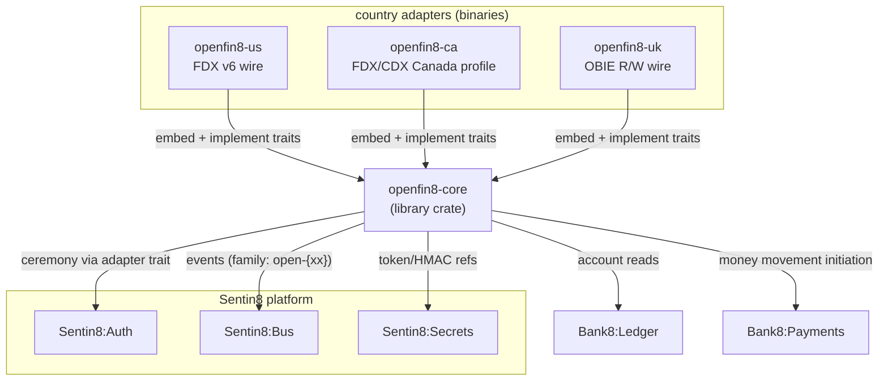

# OpenFin8:Core - README

[](LICENSE)
[](https://www.rust-lang.org/)
[](https://bank8.dev/docs/openfin8-core)
[](https://bank8.dev)

The jurisdiction-agnostic open-finance kernel: the consent ledger,
the recipient registry, the CSDF data-minimization engine, the
notification delivery worker, the admin page framework, the audit
discipline, and the wire-agnostic service traits that the
per-country adapters implement.

## Summary

`openfin8-core` is a **library crate** - no process runs on it.
Every `bank8-open-*` adapter (`openfin8-us`, `openfin8-ca`,
`openfin8-uk`, and the adapters to follow) embeds it and supplies
its wire surface, its contract table, and its registration data
through four traits: `OpenBankingProfile` (the wire descriptor),
`ConsentCeremony` (the OAuth family), `ProviderWire` (the
resource router), and `ConsentScreens` (the hosted consent flavor).

The two-ledger model from OpenFin8:CA is preserved as the foundation:
the provider's grant ledger and the recipient's consent registry
live in separate tenants, no cross-tenant SQL ever, and each
instance serves whichever role its own environment plays.

## Motivation

Multi-country open banking must not fork the consent machinery six
ways. The parts of an open-banking service that are standard-
agnostic - consent lifecycle and enforcement, recipient onboarding
and token custody, data minimization, signed notifications, audit,
admin - are the security-critical core, and they are identical
across FDX (US/CA), OBIE (UK), and the standards to follow
(Brazil, EU, Australia). Only the wire, the ceremony profile, and
the response envelope genuinely differ per jurisdiction. This crate
is the seam: everything above the traits is shared and audited
once; everything below them is thin, per-country, and isolated by
construction (a US binary cannot mount UK routes).

## Architecture & High-Level Design



Read [`DESIGN.md`](DESIGN.md) (OBARCH-1) for the full design: the
extraction inventory from OpenFin8:CA, the four trait signatures, the
generalized data model, CSDF vocabulary-as-profile-data, version
and jurisdiction configuration, and the spec-publication policy
mechanism (OBARCH-2).

## Status

**Skeleton** - the trait contract is defined (see
[`src/traits.rs`](src/traits.rs)); the module bodies (consent,
recipient, csdf, notify, admin, contract, sql, server) land with
the OBARCH-1 implementation. The per-country adapters
(`openfin8-us`, `openfin8-ca`, `openfin8-uk`) carry their own
design documents and follow the same status discipline.

## Development

```bash
make help     # the available targets
make build    # cargo build
make test     # cargo test
make lint     # cargo fmt -- --check
make tag      # print this lib's pin tag (bank8-vX)
```

This is a lib repo (RS §4.5): no captain/enroll targets - those live
on the adapter service repos that embed this crate.

## Contributing & License

Apache-2.0 (see [LICENSE](LICENSE), [NOTICE](NOTICE)). The security
model is platform-wide - read [SECURITY.md](SECURITY.md).

---

**Architecture & Design:** bank8:open-core and its underlying concepts
were designed by [Hamid Jahanzad](https://www.linkedin.com/in/hamidjahanzad/).